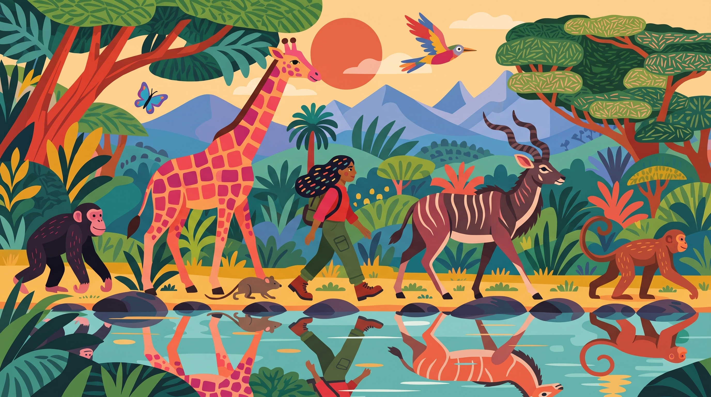
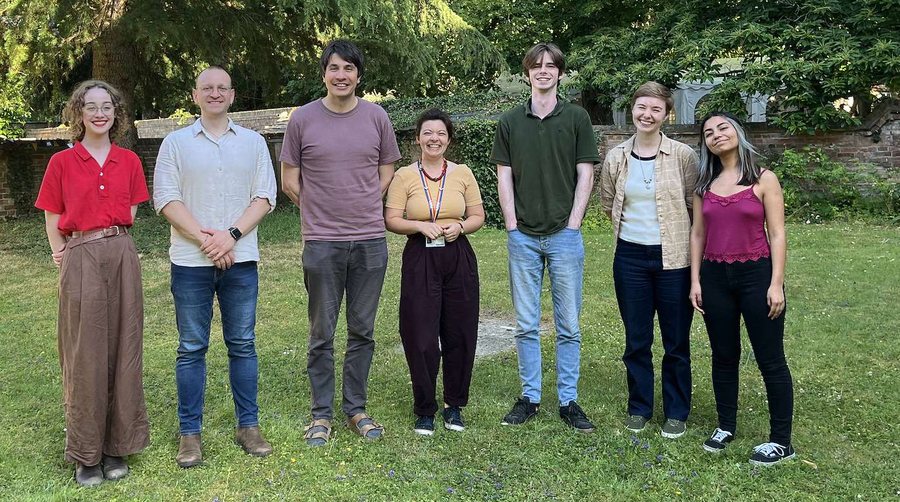

```{=html}
<div class="hero container-fluid px-4 px-md-5">
  <div class="row align-items-center">
    <div class="col-lg-7">
      <h1>A comparative perspective<br>on human uniqueness</h1>
      <hr class="hero-rule">
      <p class="lead">
        What makes us human? We believe that question only makes sense in comparative context.
        By placing our species alongside other species we identify which features of human
        anatomy, behaviour, and evolution are genuinely distinctive, which are shared, and which
        arose repeatedly across the tree of life. Human uniqueness becomes clearer, not weaker,
        when examined through a comparative lens.
      </p>
      <div class="mt-3">
        <a href="research.qmd" class="btn btn-primary me-2" style="background:var(--blue);border-color:var(--blue);">Our Research</a>
        <a href="opportunities.qmd" class="btn btn-outline-secondary">Join the Lab</a>
      </div>
      <a href="https://www.anthro.ox.ac.uk" target="_blank" class="d-inline-flex align-items-center mt-4 text-decoration-none" style="gap:0.75rem;">
        
        <span class="text-muted" style="font-size:0.85rem;line-height:1.3;">Based at the School of Anthropology<br>&amp; Museum Ethnography, University of Oxford</span>
      </a>
    </div>
    <div class="col-lg-5 mt-4 mt-lg-0 text-center">
      
    </div>
  </div>
</div>
```


---

## News {.section-title}
<hr class="section-rule">

```{=html}
<div class="news-card">
  <div class="news-date">October 2026</div>
  <p>Welcome to the <strong>Comparative Evolutionary Anthropology (CEA)</strong> group website at the University of Oxford.</p>
</div>

<div class="news-card">
  <div class="news-date">June 2026</div>
  <p>New paper in <em>PNAS</em>: <a href="https://doi.org/10.1073/pnas.2521732123" target="_blank">Competing models of hominin body size evolution</a> — Gardner, Püschel, White, Sakamoto &amp; Venditti.</p>
</div>

<div class="news-card">
  <div class="news-date">May 2026</div>
  <p>Our work on human handedness was featured in <em><a href="https://www.independent.co.uk/" target="_blank">The Independent</a></em>: <strong>"Scientists finally decode why most humans are right-handed."</strong> The study links the rise of human handedness to the evolution of bipedalism and brain expansion in hominins. <a href="https://doi.org/10.1371/journal.pbio.3003771" target="_blank">Read the paper →</a></p>
</div>

<div class="news-card">
  <div class="news-date">April 2026</div>
  <p>New paper in <em>PLOS Biology</em>: <a href="https://doi.org/10.1371/journal.pbio.3003771" target="_blank">Bipedalism and brain expansion explain human handedness</a> — Püschel, Hurwitz &amp; Venditti. Also featured in <a href="https://www.anthro.ox.ac.uk/news" target="_blank">Oxford Anthropology news</a>.</p>
</div>

<div class="news-card">
  <div class="news-date">August 2025</div>
  <p>New paper in <em>PNAS</em>: <a href="https://doi.org/10.1073/pnas.2423833122" target="_blank">The radiation and geographic expansion of primates through diverse climates</a> — Avaria-Llautureo, Püschel et al.</p>
</div>

<div class="news-card">
  <div class="news-date">October 2024</div>
  <p>New paper in <em>PNAS</em>: <a href="https://doi.org/10.1073/pnas.2409542121" target="_blank">Hominin brain size increase has emerged from within-species encephalization</a> — Püschel, Nicholson, Baker, Barton &amp; Venditti.</p>
</div>
```

---

## The Lab {.section-title}
<hr class="section-rule">

```{=html}
<div class="text-center mt-2 mb-4">
  
  <p class="text-muted mt-2" style="font-size:0.9rem;">The CEA group, Oxford, 2025</p>
</div>
```

```{=html}
<script>
(function() {
  var images = [
    'images/hero-1.jpg',
    'images/hero-2.jpg',
    'images/hero-3.jpg',
    'images/hero-4.jpg'
  ];
  var last = -1;
  try { last = parseInt(localStorage.getItem('heroIdx') || '-1', 10); } catch(e) {}
  var pool = images.map(function(_,i){return i;}).filter(function(i){return i !== last;});
  var idx = pool[Math.floor(Math.random() * pool.length)];
  try { localStorage.setItem('heroIdx', idx); } catch(e) {}
  var el = document.getElementById('hero-img');
  if (el) el.src = images[idx];
})();
</script>
```
