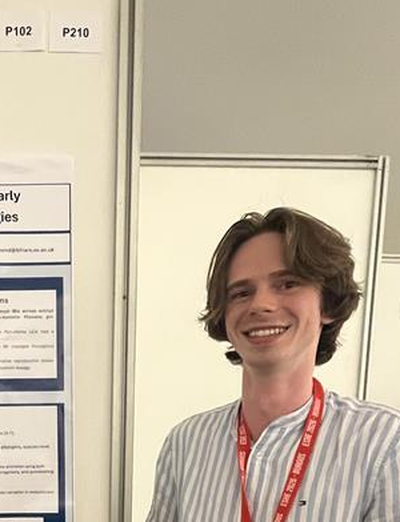
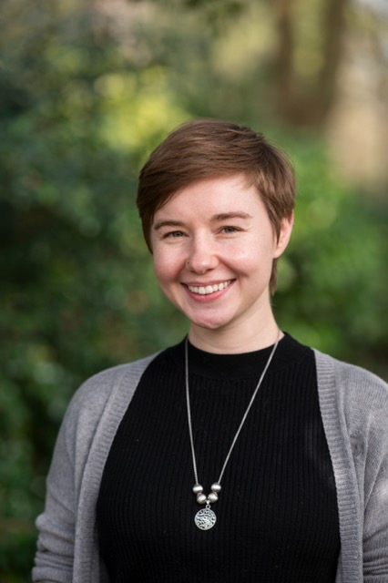
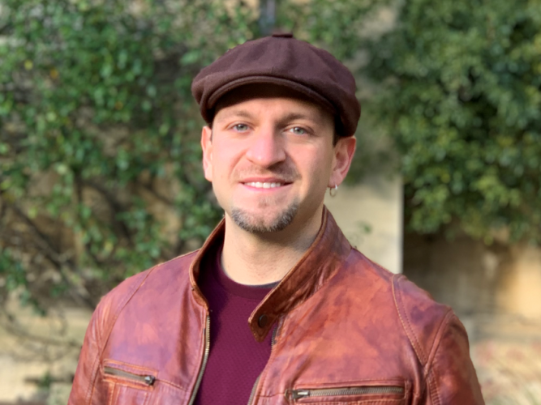

## People {.section-title}
<hr class="section-rule">

### Principal Investigator

```{=html}
<div class="row align-items-start mb-5">
  <div class="col-md-3 text-center">
    
  </div>
  <div class="col-md-9 mt-3 mt-md-0">
    <h4 style="color:var(--navy);font-weight:700;margin-bottom:0.2rem;">Thomas A. Püschel</h4>
    <div style="color:var(--blue);font-weight:600;margin-bottom:0.8rem;">
      Wendy James Associate Professor in Evolutionary Anthropology<br>
      <small style="color:var(--muted);font-weight:400;">School of Anthropology and Museum Ethnography, University of Oxford<br>
      Tutorial Fellow, St Hugh's College</small>
    </div>
    <p>
      Thomas leads the Comparative Evolutionary Anthropology (CEA) group at the University of Oxford. His research seeks to understand what makes humans unique by placing our species in comparative context — alongside other primates and mammals — and asking which features of human anatomy, behaviour, and evolution are genuinely distinctive, which are shared with our relatives, and which evolved independently across the tree of life. To address these questions he draws on an integrative toolkit spanning 3D morphometrics, virtual computational biomechanics, phylogenetic comparative methods, and fieldwork, applied to both living species and the fossil record.
    </p>
    <p>
      He completed his PhD at the University of Manchester (2018), his MSc at the University of York,
      and his undergraduate degree at the University of Chile. He was a Leverhulme Early Career Fellow
      at Oxford and a postdoctoral researcher at the University of Reading before taking up his
      current position in 2023.
    </p>
    <div style="margin-top:0.8rem;">
      <a href="https://orcid.org/0000-0002-2231-2297" target="_blank" class="btn btn-sm btn-outline-secondary me-1">ORCID</a>
      <a href="https://scholar.google.com/citations?user=v8oXbxgAAAAJ" target="_blank" class="btn btn-sm btn-outline-secondary me-1">Google Scholar</a>
      <a href="https://github.com/ThomasPueschel" target="_blank" class="btn btn-sm btn-outline-secondary me-1">GitHub</a>
      <a href="https://twitter.com/ThomasPuschel" target="_blank" class="btn btn-sm btn-outline-secondary me-1">Twitter/X</a>
      <a href="mailto:thomas.puschel@anthro.ox.ac.uk" class="btn btn-sm btn-outline-secondary">Email</a>
    </div>
  </div>
</div>
```

---

### DPhil Students

```{=html}
<div class="row g-4">

  <div class="col-md-6">
    <div class="person-card text-start" style="background:var(--blue-light);border-radius:8px;padding:1.5rem;">
      
      <h5>Reece Hammond</h5>
      <div class="role">DPhil Candidate</div>
      <p class="bio">Reece is a biological anthropologist interested in primate and hominin life history evolution. His DPhil research uses phylogenetic comparative methods and Bayesian modelling to reconstruct reproductive strategies in extinct hominins, asking how and when distinctively human patterns of interbirth interval, offspring dependency, and cooperative breeding emerged across our evolutionary lineage.</p>
      <p class="bio" style="margin-top:0.6rem;"><strong>Research interests:</strong> Life history evolution, reproductive biology, hominin evolution, phylogenetic comparative methods, Bayesian statistics</p>
    </div>
  </div>

  <div class="col-md-6">
    <div class="person-card text-start" style="background:var(--blue-light);border-radius:8px;padding:1.5rem;">
      
      <h5>Rachel Hurwitz</h5>
      <div class="role">DPhil Candidate</div>
      <p class="bio">Rachel is a biological anthropologist broadly interested in how osteological remains — and specifically the post-crania — can provide insight into modern human and primate adaptations, as well as help reconstruct the lives of our ancestors. Her DPhil research focuses on whether and how lateralized behaviours impact directional asymmetry in bones of the hand across the primate order, with a particular focus on our closest living relatives, the great apes. She has a background in human anatomy, and worked in clinical research at Michigan Medicine for four years before coming to Oxford for her MSc.</p>
      <p class="bio" style="margin-top:0.6rem;"><strong>Research interests:</strong> Osteology, palaeoanthropology, primatology, laterality, handedness, anatomy, hominin evolution</p>
      <p class="bio" style="margin-top:0.4rem;font-size:0.85rem;color:var(--muted);">MSc Cognitive &amp; Evolutionary Anthropology, University of Oxford (2023) · BS Evolutionary Anthropology, University of Michigan (2018)</p>
      <div style="margin-top:0.8rem;">
        <a href="https://orcid.org/0000-0002-3403-9056" target="_blank" class="btn btn-sm btn-outline-secondary me-1">ORCID</a>
        <a href="https://bsky.app/profile/rachel-hurwitz.bsky.social" target="_blank" class="btn btn-sm btn-outline-secondary">BlueSky</a>
      </div>
    </div>
  </div>

</div>
```


---

### Former Members

```{=html}
<div class="row g-4">

  <div class="col-md-6">
    <div class="person-card text-start" style="background:var(--blue-light);border-radius:8px;padding:1.5rem;">
      
      <h5>Dr Gabriele Paone</h5>
      <div class="role">Postdoctoral Affiliate · now at University of Oxford (School of Anthropology)</div>
      <p class="bio">Gabriele studies how children in harsh and unpredictable environments develop hidden abilities, combining experimental cognitive studies with ethnographic fieldwork in Brazilian favelas, southern Italy, Roma communities, and rural Mozambique. He also examines community-based martial arts programmes as settings for children's wellbeing, working with local NGOs to translate research findings into culturally grounded education and support initiatives.</p>
      <p class="bio" style="margin-top:0.4rem;font-size:0.85rem;color:var(--muted);">DPhil Anthropology, University of Oxford · MSc Cognitive &amp; Evolutionary Anthropology, University of Oxford</p>
      <div style="margin-top:0.8rem;">
        <a href="https://www.anthro.ox.ac.uk/people/dr-gabriele-paone" target="_blank" class="btn btn-sm btn-outline-secondary me-1">Oxford Profile</a>
        <a href="mailto:gabriele.paone@anthro.ox.ac.uk" class="btn btn-sm btn-outline-secondary">Email</a>
      </div>
    </div>
  </div>

</div>
```

---

### Collaborators

We work with researchers at institutions including the University of Reading, the University 
of Manchester, the Universitat Autònoma de Barcelona, and the University of Chile, 
as well as colleagues in the [Palaeo-Primate Project](https://www.gorongosa.org/science/palaeo-primate-project).

*Interested in collaborating? [Get in touch](mailto:thomas.puschel@anthro.ox.ac.uk).*

