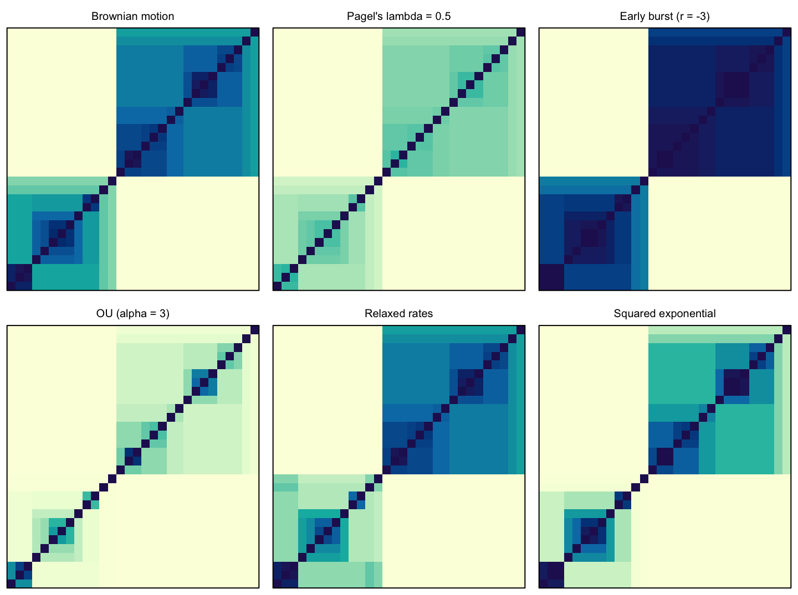

## Resources {.section-title}
<hr class="section-rule">

We develop open-source software to support phylogenetic comparative analysis. Below are tools produced by the lab that are freely available for use and adaptation.

---

### phylogp — Phylogenetic Gaussian Processes in R

**phylogp** is an R package for fitting continuous trait-evolution models on phylogenies using Gaussian processes. Rather than treating each evolutionary model as a separate algorithm, it frames them all as covariance (kernel) functions on the tree — so complex models can be built by combining simple components, validated analytically, and fitted in Stan by maximum likelihood or full Bayesian inference.

```{=html}
<div class="row g-4 mt-2 mb-4 align-items-center">
  <div class="col-lg-7">
    <h5>What it does</h5>
    <p>The package lets you compose kernels from building blocks — Brownian motion, Ornstein–Uhlenbeck,
    relaxed rates, rate-through-time, phylogeny plus geography, evolving slopes, Student-<em>t</em>
    residuals, and user-defined branch-wise kernels — check their validity on a given tree, and fit
    them with Stan via <strong>cmdstanr</strong>. Branch-wise kernels use an O(<em>N</em>) pruning
    recursion for the likelihood and an O(<em>N</em>) message-passing pass for exact leave-one-out
    densities, making it practical for large phylogenies.</p>

    <h5 class="mt-3">Key capabilities</h5>
    <ul>
      <li><strong>Kernel composition</strong> — add components to build any covariance structure</li>
      <li><strong>Validity checks</strong> — theory-based and numerical checks before fitting</li>
      <li><strong>Model comparison</strong> — PSIS-LOO cross-validation and exact LOO refits</li>
      <li><strong>Ancestral states &amp; prediction</strong> — kriging on the tree for unobserved species</li>
      <li><strong>Classical benchmarks</strong> — ML fits reproduce <code>phylolm</code> for BM, Pagel's λ/κ/δ, OU, and early burst</li>
    </ul>
  </div>
  <div class="col-lg-5 text-center">
    
    <p class="text-muted mt-2" style="font-size:0.82rem;">
      Correlation between species implied by six kernels on the same tree: Brownian motion,
      Pagel's λ, early burst, OU, relaxed rates, and a squared-exponential kernel.
    </p>
  </div>
</div>
```

#### Installation

phylogp requires [CmdStan](https://mc-stan.org/cmdstanr/) for model fitting. Install it first, then the package:

```r
# 1. Install cmdstanr and CmdStan
install.packages(c("remotes", "cmdstanr"),
                 repos = c("https://stan-dev.r-universe.dev", getOption("repos")))
cmdstanr::install_cmdstan()

# 2. Install phylogp (with vignettes — takes a few minutes)
remotes::install_github("ThomasPueschel/phylogp", build_vignettes = TRUE)
```

Kernel design tools work without Stan if you want to explore covariance structures before fitting.

#### Citation

If you use phylogp in your research, please cite:

> Püschel, T.A. *et al.* (2024). *phylogp: Phylogenetic comparative models as Gaussian processes.* EcoEvoRxiv. <https://doi.org/10.32942/X2D99V>

```{=html}
<div class="mt-3">
  <a href="https://github.com/ThomasPueschel/phylogp" target="_blank"
     class="btn btn-primary me-2" style="background:var(--blue);border-color:var(--blue);">
    <i class="bi bi-github me-1"></i> View on GitHub
  </a>
  <a href="https://doi.org/10.32942/X2D99V" target="_blank"
     class="btn btn-outline-secondary">
    Read the preprint →
  </a>
</div>
```

---

### Primate comparative datasets

A curated list of openly available datasets that are useful for comparative studies of primates. Links point to where the data are hosted. Please cite the original sources and check each dataset's licence before reuse.

::: {.table-responsive}

| Dataset | Description | Primate coverage | Data |
|:--|:--|:--|:--|
| **Phylogenies** | | | |
| 10kTrees (Arnold, Matthews & Nunn 2010, *Evol. Anthropol.*) | Consensus and posterior samples of primate trees, pruned to your chosen species | Most extant primates | [10ktrees.nunn-lab.org](https://10ktrees.nunn-lab.org/) |
| Springer et al. 2012, *PLoS ONE* | Time-calibrated primate supermatrix phylogeny (Newick trees in Text S2) | 367 species | [doi:10.1371/journal.pone.0049521](https://doi.org/10.1371/journal.pone.0049521) |
| Upham, Esselstyn & Jetz 2019, *PLoS Biol.* | Species-level posterior sets of mammal phylogenies | All extant primates (~5,900 mammals) | [Dryad](https://doi.org/10.5061/dryad.tb03d03) · [VertLife subsets](https://vertlife.org/phylosubsets/) |
| Avaria-Llautureo et al. 2025, *PNAS* | Posterior trees with fossil tips, fossil ages, palaeolocations and climate data | ~900 extant and fossil species | [Article & SI](https://doi.org/10.1073/pnas.2423833122) · [figshare](https://doi.org/10.6084/m9.figshare.29608814.v2) |
| **Fossils & calibrations** | | | |
| de Vries & Beck 2023, *Palaeontol. Electron.* | Twenty-five justified fossil calibrations for primate divergences | Primates (25 nodes) | [doi:10.26879/1249](https://doi.org/10.26879/1249) |
| Fossil Calibration Database | Curated node calibrations from the literature | Primate nodes included | [figshare](https://doi.org/10.6084/m9.figshare.34046970) |
| Paleobiology Database (PBDB) | Fossil occurrences, taxonomy and palaeocoordinates | Primates and other Euarchonta | [paleobiodb.org](https://paleobiodb.org/) |
| PHYLACINE 1.2 (Faurby et al. 2018, *Ecology*) | Ranges, traits and phylogenies for all mammals, including recently extinct species | Extant and recently extinct primates | [Dryad](https://doi.org/10.5061/dryad.bp26v20) |
| **Traits, diet & life history** | | | |
| Galán-Acedo et al. 2019, *Sci. Data* | Body mass, diet, locomotion, activity, habitat and home range | ~500 species | [Zenodo](https://zenodo.org/records/2600338) |
| EltonTraits 1.0 (Wilman et al. 2014, *Ecology*) | Diet composition, foraging stratum and activity | All extant primates (all mammals) | [figshare](https://doi.org/10.6084/m9.figshare.3559887.v1) |
| COMBINE (Soria et al. 2021, *Ecology*) | Reported and imputed life-history and ecological traits | ~520 species (all mammals) | [figshare](https://doi.org/10.6084/m9.figshare.13028255.v4) |
| PanTHERIA (Jones et al. 2009, *Ecology*) | Life history, ecology and geography | ~265 species (all mammals) | [figshare](https://doi.org/10.6084/m9.figshare.3531875.v1) |
| AnAge (Human Ageing Genomic Resources) | Longevity, ageing and life-history records | Primates included | [genomics.senescence.info](https://genomics.senescence.info/species/) |
| Gómez & Verdú 2012, *Syst. Biol.* | Diet, body mass and seed-dispersal role of extant and fossil primates | Extant and fossil species | [Dryad](https://doi.org/10.5061/dryad.kh21qb76) |
| Fulwood et al. 2021, *Paleobiology* | Tooth-shape metrics and diet predictions | Extant and fossil strepsirrhines | [Dryad](https://doi.org/10.5061/dryad.4mw6m908m) |
| **Brain size** | | | |
| DeCasien, Williams & Higham 2017, *Nat. Ecol. Evol.* | Brain and body size, diet, group size and social system | Extant primates | [Supplementary Data 1](https://doi.org/10.1038/s41559-017-0112) |
| Montgomery et al. 2010, *BMC Biol.* | Brain and body mass for extant genera and fossil species | 37 extant genera, 23 fossil species | [Additional file 1](https://doi.org/10.1186/1741-7007-8-9) |
| **Taxonomy, ranges & morphology** | | | |
| Mammal Diversity Database | Current mammal taxonomy with synonyms | All recognised primate species | [mammaldiversity.org](https://www.mammaldiversity.org/) |
| IUCN Red List spatial data | Species range polygons and threat status (free registration) | All assessed primates | [iucnredlist.org](https://www.iucnredlist.org/resources/spatial-data-download) |
| MorphoSource | 3D scans (CT, surface) of specimens | Many extant and fossil primates | [morphosource.org](https://www.morphosource.org/) |

:::
